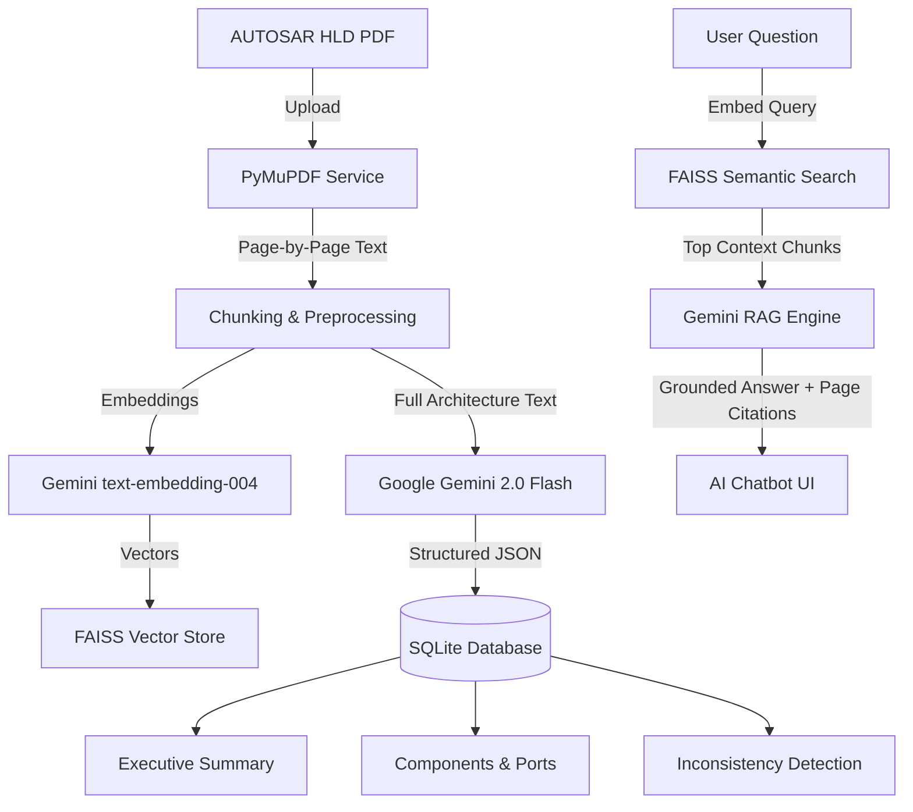

# AUTOSAR HLD Document Analysis Assistant

An intelligent, professional automotive engineering web application designed to ingest, analyze, query, and verify **AUTOSAR High-Level Design (HLD)** PDF specifications using **Python Flask, Google Gemini API, PyMuPDF, FAISS RAG, and Bootstrap 5**.

---

## Key Features

1. **Automotive Engineering Dashboard:**
   - Real-time statistics: total documents, analyzed specifications, extracted SW components, and AI queries.
   - Activity log and recent document quick actions.
2. **PDF Specification Ingestion:**
   - Drag-and-drop PDF upload with PyMuPDF text extraction.
   - Page-by-page chunking with configurable overlap.
3. **Gemini-Powered Architectural Analysis:**
   - Identifies AUTOSAR Classic and Adaptive platform specifications.
   - Extracts Software Components (SWCs, BSW, Sensor-Actuator, Complex Drivers).
   - Extracts Ports (P-Ports, R-Ports), Interfaces (SenderReceiver, ClientServer), and discrete Signals.
   - Extracts end-to-end functional execution flows.
4. **Context-Grounded AI Chatbot (RAG):**
   - Built on **FAISS** vector search and Google Gemini embeddings (`models/text-embedding-004`).
   - Retrieves top semantic chunks from the document.
   - Every answer includes exact page references (e.g., `Page 2`, `Page 4`) and strictly prevents hallucinations.
5. **Architectural Inconsistency Detection:**
   - Detects missing dependencies between SWCs.
   - Flags mismatched or unmapped interfaces and ports.
   - Highlights incomplete architectural sections and assigns severity levels (`High`, `Medium`, `Low`).
   - Suggests prioritized engineering recommendations.
6. **Searchable Component Inventory:**
   - Interactive data tables for components, interfaces, ports, and signals with real-time text filtering and document scoping.
7. **Document Comparison (Diff Engine):**
   - Compares two HLD specifications (e.g., baseline vs. revision).
   - Generates an architectural similarity score, common vs. unique elements, and interface compatibility risks.
8. **Multi-Format Report Export:**
   - Export full analysis as structured **JSON**.
   - Export components and inconsistencies to **CSV**.
   - Generate high-fidelity, printable **HTML Reports** with print media styles.

---

## Architectural Architecture



---

## Technology Stack

- **Backend:** Python 3.10+, Flask, SQLAlchemy (SQLite), Werkzeug
- **AI / LLM:** `google-genai` SDK, Gemini 2.0 Flash, Gemini text-embedding-004
- **PDF Extraction:** PyMuPDF (`fitz`)
- **Semantic Vector Search:** FAISS (`faiss-cpu`), NumPy
- **Frontend:** HTML5, CSS3, Bootstrap 5.3, Bootstrap Icons, JavaScript (Fetch API)

---

## Project Structure

```
Tata-Techpulse/
├── app.py                      # Flask Application Factory & Initialization
├── config.py                   # App Configuration & Environment loader
├── create_sample_pdf.py        # Generates sample AUTOSAR HLD PDFs
├── requirements.txt            # Python Dependencies
├── .env.example                # Sample Environment Variables
├── .gitignore                  # Git Ignore configuration
├── README.md                   # Project Documentation
├── database/
│   ├── __init__.py
│   └── models.py               # SQLAlchemy Database Models
├── services/
│   ├── __init__.py
│   ├── pdf_service.py          # PyMuPDF extraction & chunking
│   ├── gemini_service.py       # Google Gemini SDK Integration
│   ├── rag_service.py          # FAISS semantic vector indexer
│   └── analysis_service.py    # Pipeline orchestration
├── routes/
│   ├── __init__.py
│   ├── main.py                 # Dashboard & KPI routes
│   ├── documents.py            # PDF upload, listing & download
│   ├── analysis.py             # Analysis, components & comparison
│   ├── chatbot.py              # AI Chatbot & RAG Q&A
│   └── reports.py              # JSON, CSV & printable HTML reports
├── static/
│   ├── css/style.css           # Automotive Navy/White/Light-Blue Styling
│   ├── js/main.js              # Frontend UI logic
│   └── uploads/                # Secure PDF upload repository
└── templates/
    ├── base.html               # Shared layout & navigation
    ├── dashboard.html          # Engineering KPI dashboard
    ├── upload.html             # PDF upload drop-zone
    ├── documents.html          # Document details & management
    ├── analysis.html           # Full architectural analysis & tabs
    ├── chatbot.html            # RAG AI Chatbot with source citations
    ├── components.html         # Searchable component inventory
    ├── comparison.html         # Side-by-side document comparison
    ├── reports.html            # Report download index
    └── report_print.html       # Print-ready architectural report
```

---

## Installation & Setup on Windows

### 1. Prerequisites
- **Python 3.10 or newer** installed and available in PATH.
- Git (optional).
- A **Google Gemini API Key** (obtain free from [Google AI Studio](https://aistudio.google.com/app/apikey)).

### 2. Clone or Open Workspace
Open PowerShell in the project directory:
```powershell
cd c:\Users\chait\OneDrive\Desktop\Tata-Techpulse
```

### 3. Create and Activate Virtual Environment
```powershell
# Create virtual environment
python -m venv venv

# Activate on Windows PowerShell
.\venv\Scripts\Activate.ps1
```
*(If PowerShell restricts script execution, run `Set-ExecutionPolicy -ExecutionPolicy RemoteSigned -Scope Process` first).*

### 4. Install Dependencies
```powershell
pip install --upgrade pip
pip install -r requirements.txt
```

### 5. Configure Environment Variables
Copy `.env.example` to `.env`:
```powershell
Copy-Item .env.example .env
```
Open `.env` in any text editor and supply your Gemini API key:
```ini
GEMINI_API_KEY=your_actual_gemini_api_key_here
GEMINI_MODEL=gemini-2.0-flash
GEMINI_EMBED_MODEL=models/text-embedding-004
SECRET_KEY=autosar-secure-key-2026
```

---

## Execution Guide

### 1. (Optional) Generate Sample AUTOSAR HLD PDFs for Testing
We provide a helper script to generate two realistic sample AUTOSAR HLD PDFs (`Sample_AUTOSAR_Powertrain_HLD.pdf` and `Sample_AUTOSAR_Powertrain_HLD_v5.pdf`):
```powershell
python create_sample_pdf.py
```

### 2. Start the Web Server
```powershell
python app.py
```
By default, the server starts at:
```
http://127.0.0.1:5000
```
Open this URL in your web browser.

---

## User Workflow & Walkthrough

1. **Dashboard:**
   - View top-level engineering statistics and recent activities.
2. **Upload HLD:**
   - Navigate to **Upload PDF** or click the quick action button.
   - Drag and drop `Sample_AUTOSAR_Powertrain_HLD.pdf` (or your own AUTOSAR design PDF).
3. **Run AI Analysis:**
   - Click **Run AI Analysis**.
   - The app extracts the text, builds a local FAISS index, and invokes Gemini to extract components, interfaces, and architecture gaps.
4. **Review Architecture:**
   - Inspect the **Executive Summary**, **Components & Ports**, **Interfaces & Signals**, and **Functional Flows**.
   - Review **Inconsistencies & Gaps** to see unmapped ports or missing dependencies flagged with severity levels.
5. **AI Chatbot with Page Grounding:**
   - Head to **AI Chat**.
   - Select your document and ask questions like:
     - *"What software components are defined?"*
     - *"What signals are sent to the inverter controller?"*
     - *"What are the missing dependencies flagged in the architecture?"*
   - Notice the exact page badges provided in the assistant's response.
6. **Component Inventory:**
   - Browse all extracted components, filter by document, or search across names and descriptions.
7. **Compare Two Documents:**
   - Upload a second revision (e.g. `Sample_AUTOSAR_Powertrain_HLD_v5.pdf`).
   - Head to **Compare** to view architectural variations, migration deltas, and similarity scores.
8. **Export Reports:**
   - Head to **Reports** to download structured JSON, CSV tables, or print the report to PDF.

---

## Security & Best Practices

- Secure file uploads using Werkzeug's `secure_filename`.
- API keys kept safe in `.env` and excluded via `.gitignore`.
- RAG temperature set low (`0.1` - `0.2`) for factual consistency.
- Input validation on questions and file sizes (up to 50MB).
